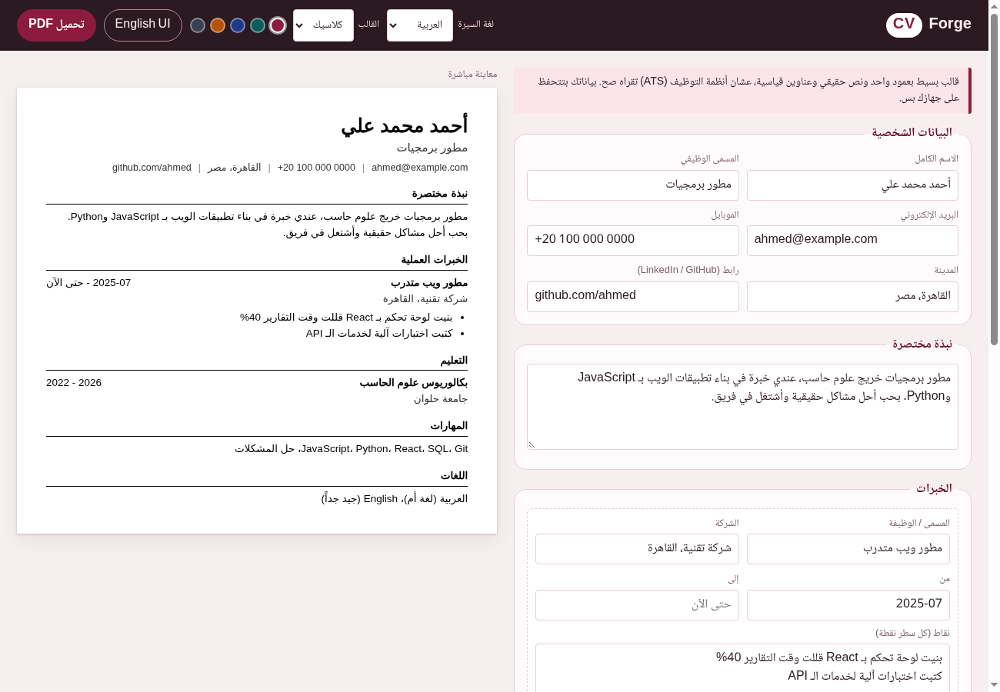
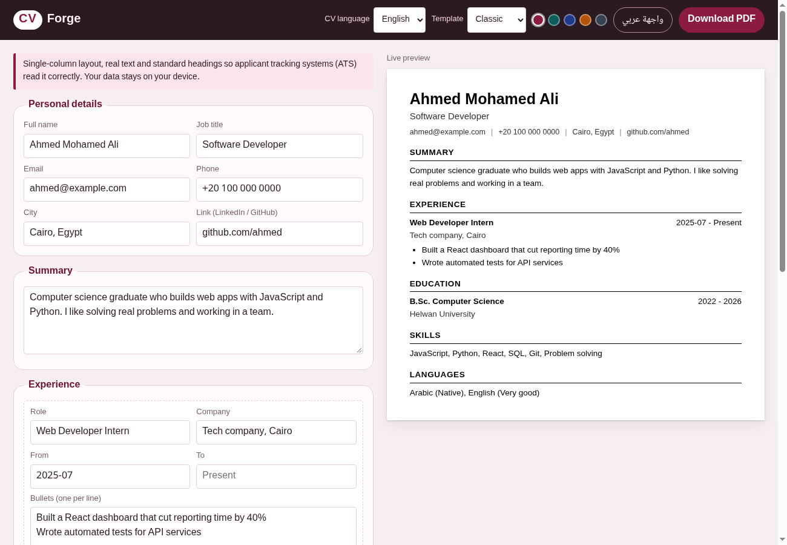

# CVForge

Free bilingual (Arabic / English) CV builder that produces an ATS-friendly resume. No sign-up, no server.

مولد سيرة ذاتية مجاني بالعربي والإنجليزي، بتصميم بسيط تقراه أنظمة التوظيف (ATS) صح. من غير تسجيل ومن غير سيرفر.

**Live demo / الموقع:** https://mostaaafaomran-ctrl.github.io/cvforge/




## Features / المميزات

- Live preview while you type.
  معاينة مباشرة وإنت بتكتب.
- CV in Arabic (RTL) or English (LTR), independent of the interface language.
  السيرة بالعربي (من اليمين) أو بالإنجليزي، منفصلة عن لغة الواجهة.
- 4 templates (Classic, Modern, Compact, Elegant) and 5 accent colors.
  4 قوالب (كلاسيك، مودرن، مدمج، أنيق) و5 ألوان.
- ATS-friendly: one column, real selectable text, standard section headings, no tables, no images.
  مناسبة للـ ATS: عمود واحد، نص حقيقي، عناوين قياسية، من غير جداول أو صور.
- Download as PDF through the browser print dialog (A4 layout).
  تحميل PDF من نافذة الطباعة (مقاس A4).
- Data saved in your browser only. Export and import as a file.
  بياناتك على جهازك بس، وتقدر تحفظها كملف وترجعها.

## Run locally / التشغيل محلياً

Plain HTML, CSS and JavaScript. No build step.
ملفات HTML وCSS وJavaScript عادية من غير بناء.

```
git clone https://github.com/mostaaafaomran-ctrl/cvforge
cd cvforge
# open index.html in a browser, or:
python3 -m http.server 8000
```

## Tips for a good ATS CV / نصايح

- Use the standard titles and plain dates (2023-06).
  استخدم العناوين القياسية وتواريخ بسيطة.
- Start each bullet with what you did and add a number when you can.
  ابدأ كل نقطة بشيء عملته وحط رقم لو تقدر.
- Save as PDF and check you can select the text.
  احفظ PDF وتأكد إنك تقدر تحدد النص.

## License / الرخصة

MIT
